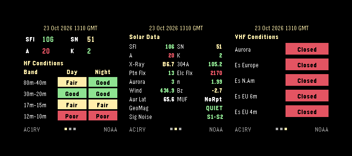

# HF Bands

HF Bands is a Pebble Time 2 watch app for checking amateur-radio propagation conditions and solar activity from your wrist. It presents HF day/night conditions, solar and geomagnetic indicators, and VHF propagation reports across three screens.



## Features

- **HF Conditions:** Color-coded daytime and nighttime conditions for 80–40 m, 30–20 m, 17–15 m, and 12–10 m, alongside solar flux (SFI), sunspot number (SN), and A/K indices.
- **Solar Data:** Solar X-ray, 304 Å emission, proton and electron flux, auroral indicators, solar wind, Bz, geomagnetic field, signal noise, and maximum usable frequency (MUF), when the source provides them.
- **VHF Conditions:** Reports for aurora and sporadic-E openings in Europe and North America.
- **Simple controls:** Up/Down switch between screens; Select requests a refresh.
- **Cached readings:** Previously received data can be displayed when a fresh download is unavailable.
- **Automatic updates:** The watch requests updated data approximately hourly while the app is running.

## Compatibility

- **Watch:** Pebble Time 2 (Emery)
- **Type:** Watch app, not a watchface
- **Connection:** Requires a paired phone with an internet connection for new data
- **Version:** 1.0.0

The current build targets Emery only. Compatibility with other Pebble models is not claimed.

## Data sources

The companion JavaScript first requests the solar XML feed from [HamQSL](https://www.hamqsl.com/solar.html) (N0NBH). If that feed is unavailable, it attempts to retrieve selected measurements from [NOAA Space Weather Prediction Center](https://www.swpc.noaa.gov/).

**Data interpretation:** HamQSL's HF and VHF condition labels are feed-provided assessments, not direct measurements at your operating location. In NOAA fallback mode, the app estimates broad HF day/night condition categories from solar flux and K-index values; these are simplified heuristic estimates, **not** VOACAP predictions or location-specific propagation forecasts. Some fields may be unavailable or display placeholders in fallback mode. VHF fallback labels are likewise coarse indicators, not verified band openings. The display's source attribution helps indicate which feed was used.

Propagation depends on frequency, path, location, time, and many other factors. Use the displayed conditions as a general reference rather than a guarantee of a contact.

## Controls

| Button | Action |
| --- | --- |
| Up | Previous screen |
| Down | Next screen |
| Select | Request fresh data |
| Back | Exit the app |

## Build and install

Install the [rePebble SDK](https://developer.repebble.com/) and use:

```sh
git clone https://github.com/Darachnid/pebble-band-conditions-time2.git
cd pebble-band-conditions-time2
pebble build
```

The build creates a `.pbw` package under `build/`. Install it using your configured Pebble development connection, for example:

```sh
pebble install --cloudpebble
```

## Pebble Store assets

The `store/` directory contains:

- `banner-emery.png` — store banner
- `icon-80.png` — small icon
- `icon-144.png` — large icon

Use screenshots captured from the running Emery build for the app listing. Verify the PBW metadata, screenshots, and app operation on the watch before submission.

## Credits

Developed by [Darachnid](https://github.com/Darachnid). Solar and propagation information is provided by the respective HamQSL/N0NBH and NOAA SWPC services. This project is not affiliated with or endorsed by those services.

## Source code

[GitHub repository](https://github.com/Darachnid/pebble-band-conditions-time2)
